# 💧 DropWise

**More than two billion people still have no safely managed drinking water, and the problem feels too big and too far away to touch.** DropWise makes it concrete: it shows where Earth's water really is, and lets you try the five fixes that work — in a field, a treatment plant, a desalination plant, a leaking pipe network and your own kitchen.

Built for **Sustainable Development Goal 6, Clean Water and Sanitation**. Entry for **Infomatrix 2027**, category **Software Development** (Project Contest), by **Nicole Puzur**, supervised by **Azamat Jayush**.

### 🔴 Live app → [drop-wise-s8pt.vercel.app](https://drop-wise-s8pt.vercel.app)

### 📦 Source code → [github.com/nicolepuzur/DropWise](https://github.com/nicolepuzur/DropWise)

### Infomatrix requirements checklist

Checked against the official [regulations](https://www.infomatrix.ro/guide/regulations.html), the [Software Development page](https://www.infomatrix.ro/categories/software-development.html) and the [evaluation rubric](https://www.infomatrix.ro/guide/evaluation-rubrics.html), read on 27 October 2026. The regulations state that rules can change without notice, so they are to be re-read before submitting.

| Requirement | Where it is met |
|---|---|
| Entry and documentation in English (Regulations §5) | The site opens in English by default (Romanian and Russian are optional); all documentation is in English |
| At most two students and a supervisor, as distinct roles (§2, §5) | [People involved](#2-people-involved): one student and one supervisor |
| Project description with idea sketches or images (§5) | [Description](#1-project-description), [screenshots](#screenshots) and the [design plan](docs/design/plan.svg) |
| Early draft plans and designs (§5, §6) | [Early-stage plan & design decisions](#3-early-stage-plan-design-decisions--timeline) and the [design plan](docs/design/plan.svg) |
| Development iterations and a timeline (§5, §6) | [Development timeline](#development-timeline) and the Git history |
| Lists of software and hardware (§5, §6) | [Specifications](#5-software--hardware-specifications) |
| Names of contributors (§6) | [People involved](#2-people-involved) |
| Problems encountered and their solutions (§6) | [Problems faced](#6-problems-faced--how-they-were-solved) |
| Open source, not subject to anyone's proprietary rights (§10) | Public repository under the [MIT licence](LICENSE) |
| No third-party rights infringed (§13) | [Third-party content & licences](#third-party-content--licences); no photographs or illustrations from other sources |
| Cite all prompts, models and AI resources, in the documentation and the presentation (Software Development page) | [Responsible AI](#7-responsible-ai-usage), the full [AI usage log](docs/AI_USAGE.md), and the site's *About* page |
| Documentation uploaded with the entry (§6) | This README with the AI usage log as an appendix, also as a PDF: [docs/DropWise-documentation.pdf](docs/DropWise-documentation.pdf) |
| A real-world problem, practical and user-friendly | [The problem](#the-problem); the app works on desktop and phone |

### How the nine judging criteria are addressed

The jury scores nine criteria from 1 to 5. This is where the project answers each one; the scores are the jury's to give.

| Criterion | What the project does |
|---|---|
| Originality / creativity | Each of the five solutions in the brief becomes a small model you can change; the planet is poured into 100 litres, with lakes and rivers drawn at their true size; the leak hunter is a game; the six hero scenes are drawn in code |
| Practicality | A real problem (SDG 6) with cited numbers; every tool ends in litres a person, farm or city could save; no account, no install, works on a phone |
| UI / UX | A full-screen slideshow, navigation on the right, three languages, a skip link, visible focus, keyboard control of the slideshow, and no forced motion for people who ask for less |
| Functionality | 52 automated tests, inputs clamped and saved data re-validated, every page checked automatically in English, Romanian and Russian at desktop and phone size (layout and console errors) and by eye on the main pages; limits of the models are written next to each tool |
| Technical skills | React 19, TypeScript and Tailwind v4; pure, tested calculation modules; a custom i18n layer with a test that keeps three languages in step; SVG scenes from seeded random numbers; a pinned horizontal scroll row; validated local storage |
| Oral presentation | A 15-minute outline with the demo flow and likely questions is in [docs/SUBMISSION.md](docs/SUBMISSION.md) |
| Documentation | This README and its PDF, the [design plan](docs/design/plan.svg), the [AI usage log](docs/AI_USAGE.md), screenshots, sources and a licence table |
| The stand design | A poster and booth plan is in [docs/SUBMISSION.md](docs/SUBMISSION.md) |
| Responsible AI usage | Tool, model and every prompt cited; the checks that were run; a step-by-step process to reproduce the build; no AI-generated images; licensing and privacy covered ([AI usage log](docs/AI_USAGE.md)) |

Official dates (from [infomatrix.ro](https://www.infomatrix.ro)): registration for Season 2027 opens on 1 January 2027, the submission deadline is **15 March 2027** (documentation, source code and a demo video), finalists are announced on **20 March 2027**, and the Global Finals are in Bucharest on **27–31 May 2027**.

---

## 1. Project Description

### The problem

- **2.1 billion people** lacked safely managed drinking water in 2024, and 106 million still drank directly from untreated surface water ([WHO/UNICEF JMP, 2025](https://data.unicef.org/resources/jmp-report-2025/))
- Only about **2.5 %** of Earth's water is fresh, and of that, lakes hold just 0.26 % and rivers a fraction of a percent ([USGS Water Science School](https://www.usgs.gov/special-topic/water-science-school/science/where-earths-water))
- Agriculture takes about **70 %** of all fresh water withdrawn worldwide, and inefficient irrigation wastes much of it ([FAO](https://www.fao.org/aquastat))
- About **126 billion m³** of piped water is lost or unaccounted for every year (Liemberger & Wyatt, *Quantifying the global non-revenue water problem*, *Water Supply*, 2019), and a leaking tap alone can waste thousands of litres a year ([US EPA](https://www.epa.gov/watersense/fix-leak-week))

The causes are agriculture, the pollution of rivers and groundwater, and ever more frequent droughts. The numbers are global and abstract, though; nobody sees them in their own tap.

### The solution

Five tools, one for each solution in the project brief:

1. **Irrigation lab** — pick a field size, a crop and how it is watered today, and see the water taken from the source with flood, sprinkler and drip irrigation, and what switching to drip saves (in Olympic swimming pools).
2. **Reuse loop** — follow the water from the taps to the treatment plant, where the pipe splits into what is reused and what is released. Set the city size, the water used per person and the share reused (with a shortcut for Israel's level).
3. **Solar desalination sizer** — how much electricity, how many solar panels (and football pitches of them) and how much brine a city's water needs, for three plant efficiencies and three sunny places.
4. **Leak hunter** — a game: a city loses 38 % of its water through six invisible leaks. Dig to find them, with and without pressure sensors, and count the dry holes.
5. **Home water audit** — shorter showers, tap aerators, a dripping tap and a rain barrel, each counted in litres. Add actions to a plan; the plan total follows you in the navigation.

Before the tools, the **Problem** page pours the planet into 100 litres (each dot is a litre) to show how little is drinkable, and lays out the three causes; the **Solution** page gives each fix with a real example and *the catch*.

Available in **English, Romanian and Russian**. Everything you enter stays in your own browser; there are no accounts.

### How it is different

- **Honest numbers.** Every statistic names its source; every tool shows its formula; estimates are labelled estimates. Where sources differ (drip savings, Israel's reuse rate) the page says so.
- **Every solution comes with its catch** — cost, energy, brine, trust — instead of promising a miracle.
- **A slideshow home page** in the spirit of [magnesia.cz](https://www.magnesia.cz): a full-screen hero with six animated scenes, a pinned horizontal row of solution cards, image breaks, numbered causes, counting statistics and an FAQ.
- **Navigation on the right**: a fixed panel on large screens, a drawer that slides in from the right on phones.
- **No tracking, no accounts, no backend to run.**

### Screenshots

Taken from the running app at 1440 × 900 (phone shots at 390 × 844).

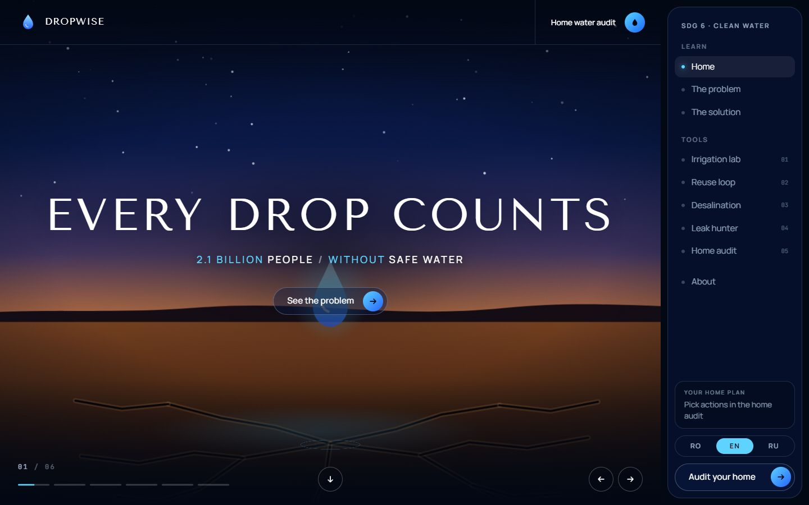

*Home — the full-screen slideshow, the header with its quick action, and the navigation panel on the right.*

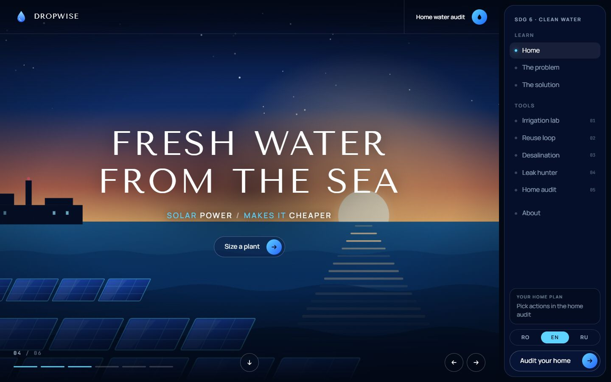

*Slide 4 of 6 — every slide is an animated scene drawn in code, with a wide headline, a coloured tag line and a capsule button.*

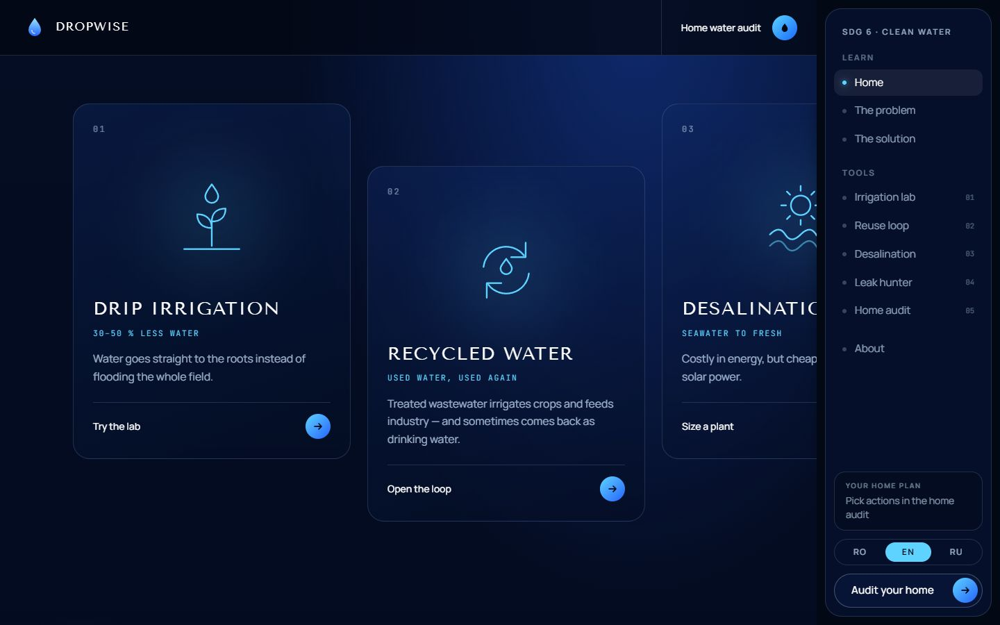

*The five solutions on a track that slides sideways as the page scrolls, with the cards staggered like the product row on the reference site.*

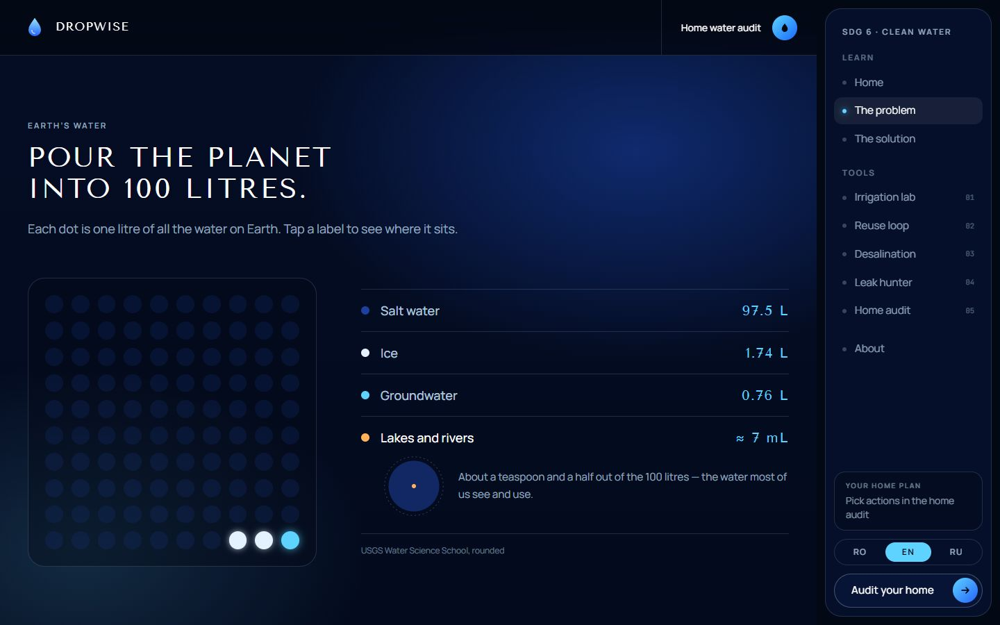

*Problem — the planet poured into 100 litres. Lakes and rivers are drawn at their true size: about 7 mL, a speck inside one dot.*

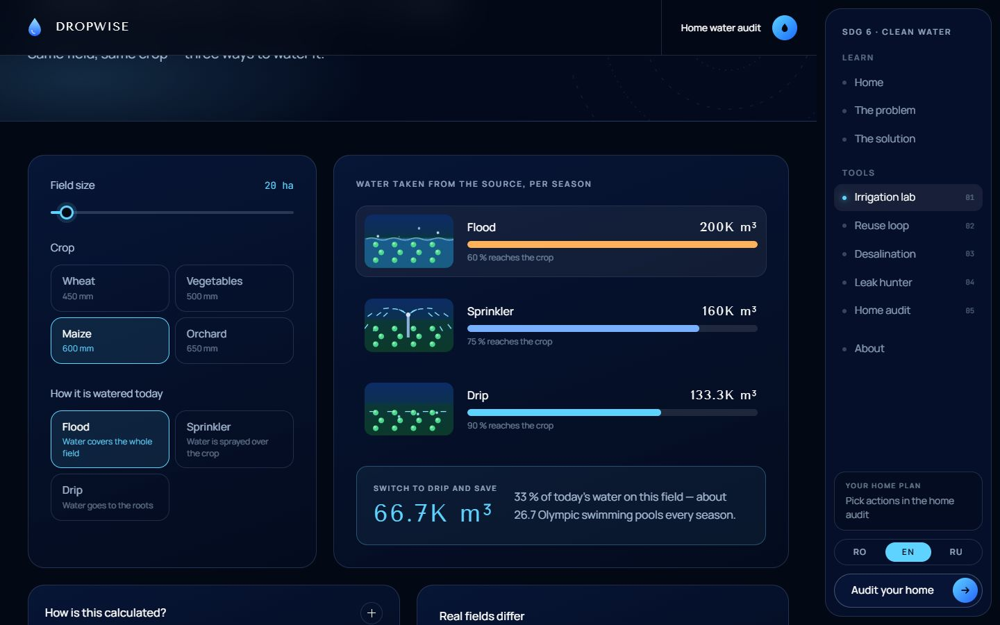

*Irrigation lab — the same field watered by flood, sprinkler and drip, and what the switch to drip saves.*

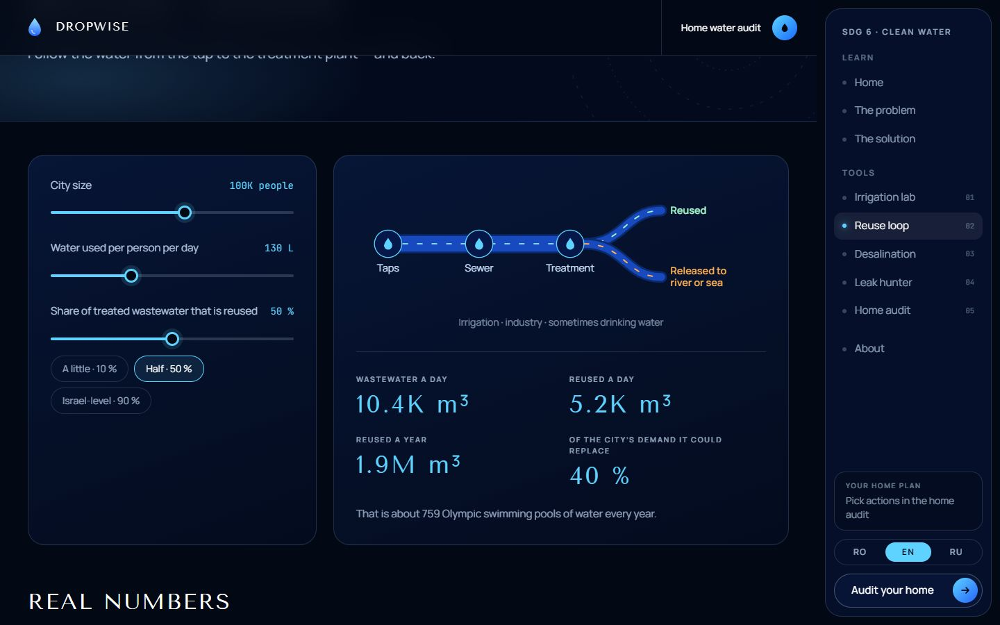

*Reuse loop — the pipe splits into what is reused and what is released; the width follows the slider.*

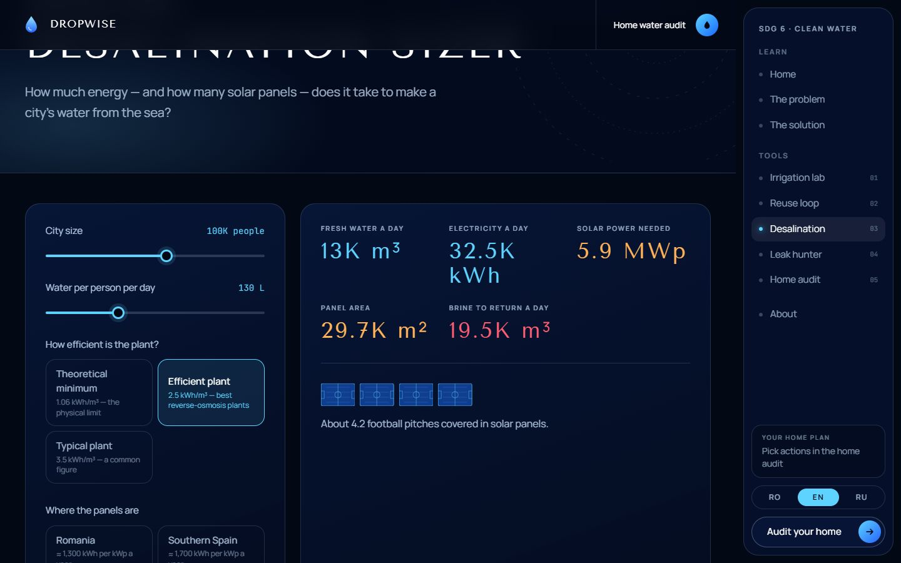

*Solar desalination sizer — electricity, solar power, panel area in football pitches, and the brine to return.*

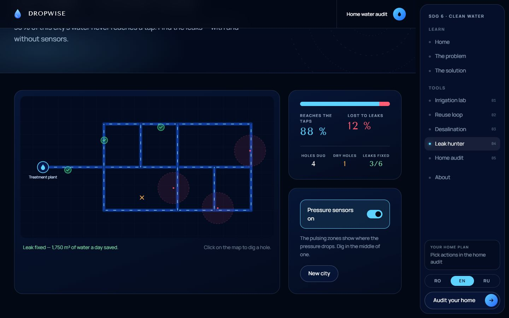

*Leak hunter — three of six leaks fixed with the help of pressure sensors, one dry hole, and the gauge falling from 38 % to 12 % lost.*

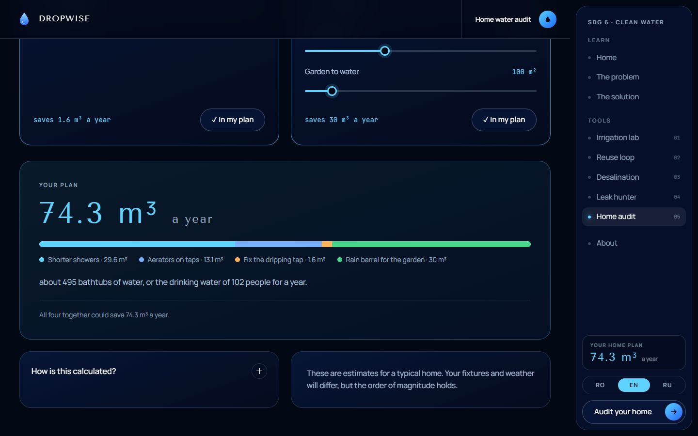

*Home water audit — four actions added to a plan; the total also shows in the navigation.*

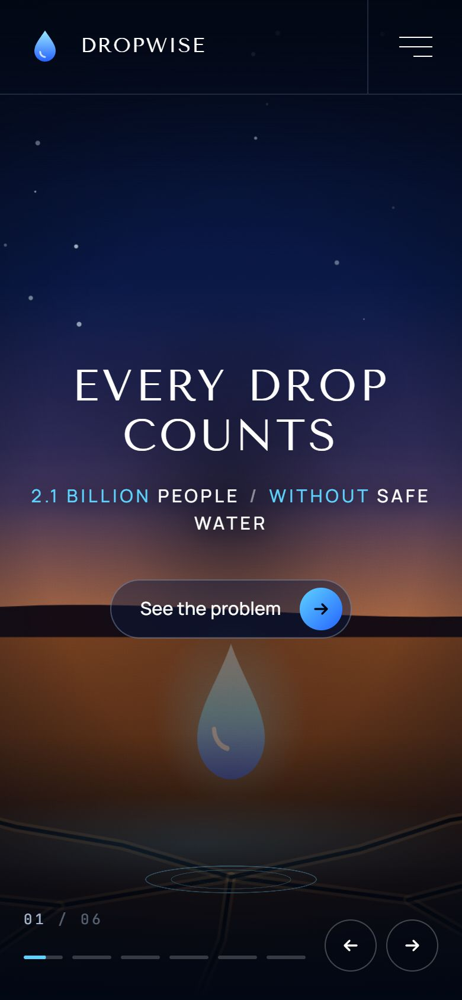 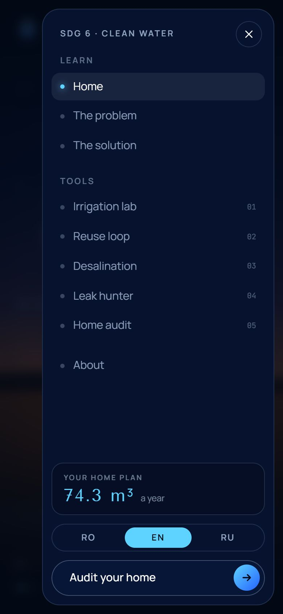

*The same app on a phone — the menu button opens a drawer that slides in from the right.*

---

## 2. People Involved

| Role | Name |
|---|---|
| Student developer | Nicole Puzur (GitHub: [nicolepuzur](https://github.com/nicolepuzur)) |
| Supervisor | Azamat Jayush |

Team size: 1 student (solo entry), within the category's 1–2 student limit.

---

## 3. Early-Stage Plan, Design Decisions & Timeline

The project started from one framing question: *how do you make "2 billion people without safe water" something one person can feel and act on?* Three early decisions followed:

1. **One tool per solution.** The brief lists five solutions (agriculture, recycling, desalination, network losses, home), so each gets a small interactive model in which a person can change the numbers.
2. **Show the shortage before the fixes.** The 100-litre pour on the Problem page gives the scale in one picture, so the solutions have something to answer.
3. **Pure functions, tested.** The maths of every tool lives in a small tested module (`src/utils`), separate from the pages, so the numbers can be checked without the interface.

The structure follows the student's earlier projects (ClimaWatch, WasteLand and PlasticFree): a Problem page, a Solution page, interactive tools, an About page, English / Romanian / Russian and a test suite. The look follows a reference site, [Magnesia](https://www.magnesia.cz): ink-navy sections lit by blue light, wide tracked capitals, a full-screen cinematic hero slideshow, capsule buttons with a luminous round arrow, a horizontal row of cards that slides sideways as the page scrolls, and smooth wheel scrolling. Only the *visual language* was taken; no code, images or fonts were copied. The reference's headline typeface (Aviano Sans) is commercial, so **Tenor Sans** is used instead, with **Manrope** for body text. Its photographs are replaced by scenes drawn in code. The navigation sits on the **right**.

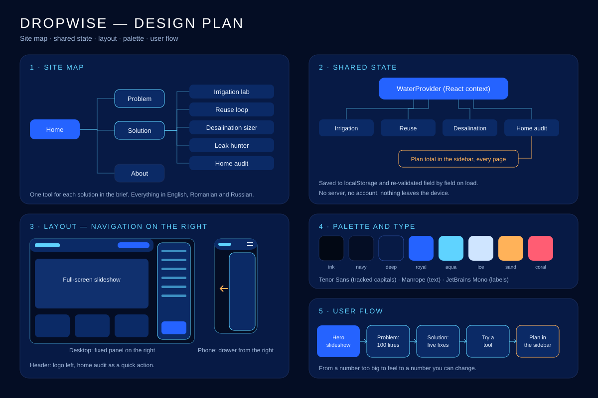

*Design plan — the site map, how the tools share one state, the layout with the navigation on the right (desktop and phone), the palette and the user flow.*

### Development timeline

| Date | What happened |
|---|---|
| **27 Oct 2026** | **Research and plan.** Studied the structure of the earlier projects and the Magnesia reference; checked the key statistics against their sources (JMP, USGS, FAO, EPA, European Commission and others). |
| **27 Oct 2026** | **Project and logic.** Vite + React + TypeScript scaffold, Tailwind v4 tokens, and the tested core: Earth's water, irrigation, reuse, desalination, leaks, home audit, number formatting and validated local storage. |
| **27 Oct 2026** | **Interface and content.** English, Romanian and Russian translations (with a test that they stay in step), the right-hand navigation, the six-scene hero slideshow and the pinned solution row, and every page. |
| **27–28 Oct 2026** | **Checks.** The main pages were looked at in a browser, then every page was run in English, Romanian and Russian at desktop and phone size with an automated layout check (no sideways scrolling, no text outside its box, no console errors); the fixes are listed in [Problems faced](#6-problems-faced--how-they-were-solved). |
| **27 Oct 2026** | **Publication and documentation.** Public GitHub repository on the student's account, live deployment on Vercel, the team credited on the site, a design-plan sketch, this README as a PDF, and the AI usage log extended with a reproducible process. The README was checked against the official regulations, category page and rubric. |

---

## 4. Architecture

```
Browser (React, no server of ours)
┌────────────────────────────────────────────────────────────────────┐
│  pages/       Home, Problem, Solution, Irrigation, Reuse,            │
│               Desalination, Leaks, AtHome, About                     │
│  components/  Header, Sidebar (right), HeroSlideshow, SolutionRail,  │
│               ImageBand, EarthWater, scenes/Scene (6 SVG scenes) ... │
│  context/     WaterProvider: the inputs of every tool, saved to      │
│               localStorage and validated on load                     │
│  utils/       earth · irrigation · reuse · desal · leaks · home ·    │
│               format · storage   (pure functions, unit-tested)       │
└────────────────────────────────────────────────────────────────────┘
        embeds only: Our World in Data chart, TED-Ed video (YouTube)
```

- **State.** One React context holds what the user enters. It is saved to `localStorage` and re-validated field by field on load (`utils/storage.ts`), so a corrupted or hand-edited entry can never crash the app.
- **One shared number.** The home audit's plan total (`utils/home.ts`) is shown in the navigation on every page.
- **Scenes.** The six hero scenes are SVG with CSS animations, drawn from seeded random numbers so they look the same on every visit. Slides that are out of view have their animations paused.
- **Pinned row.** On large screens the solution cards sit on a track inside a sticky container; the page's scroll position is turned into a sideways shift. On phones it is an ordinary swipeable row.
- **No backend.** There is nothing to hide and nothing to host.

---

## 5. Software & Hardware Specifications

| | |
|---|---|
| Frontend | React 19, TypeScript, Vite, Tailwind CSS v4, React Router |
| Smooth scrolling | [Lenis](https://lenis.darkroom.engineering) (MIT); off for reduced-motion users |
| Charts & animation | Hand-written SVG and CSS — no chart or animation library |
| Chart embed | [Our World in Data](https://ourworldindata.org/grapher/agricultural-water-as-a-share-of-total-water-withdrawals) |
| Translations | Custom React context, English / Romanian / Russian, no external library |
| Typography | Tenor Sans, Manrope and JetBrains Mono (Google Fonts, SIL Open Font License) |
| Testing | Vitest |
| Hardware | None. DropWise is a web application; it runs in any modern browser on any device with an internet connection. |

### Project structure

```
src/
  components/      Header, Sidebar, SidebarBody, HeroSlideshow, SolutionRail, ImageBand, EarthWater, ...
    scenes/        Scene.tsx — the six animated SVG scenes
  pages/           Home, Problem, Solution, Irrigation, Reuse, Desal, Leaks, AtHome, About
  context/         WaterProvider (shared state)
  hooks/           useCountUp, useInView, useMediaQuery, useScrolled
  i18n/            en / ro / ru translations + language context
  utils/           earth, irrigation, reuse, desal, leaks, home, format, storage, scroll (+ tests)
  constants/       Routes, external links
```

---

## 6. Problems Faced & How They Were Solved

- **Sources disagree on some numbers.** Drip savings are quoted as 30–50 % in some places and up to 40 % in others; Israel's reuse is reported between about 85 and 90 % depending on how wastewater is counted. *Solution:* the pages give the range, name the sources and say the figure depends on the method; the irrigation lab computes its own result from stated efficiencies instead of repeating a headline.
- **Not every figure could be confirmed at the primary source.** Singapore's "up to 40 %" for NEWater was found in secondary reporting, and the PUB page did not repeat it. *Solution:* it is worded as "reported", attributed to PUB, and flagged in the README sources so it can be re-checked before submission.
- **Unit symbols in capital letters.** The headline style turns text to uppercase, which made cubic metres read "M³" and kilowatt-hours "KWH". *Solution:* numeric displays opt out of the uppercase style.
- **A wrong unit for megawatts.** The first version glued an "M" in front of "kWp" and wrote "MkWp". *Solution:* a proper `MWp` unit in every language.
- **Dots spilling out of their frame.** The 100-litre grid used percentage gaps, which collapse in an auto-height container and let the dots spill out of their frame. *Solution:* fixed rem gaps.
- **Grey blocks before a section revealed itself.** Cells that fade in on scroll showed the divider colour behind them. *Solution:* the cells carry their own borders over a plain background.
- **Text on a bright sunset.** The tag line under the "Fresh water from the sea" headline disappeared against the glow. *Solution:* a soft dark vignette behind the text and a text shadow.
- **A drop falling through the headline.** The tap scene's drop crossed the centred text. *Solution:* the faucet moved to the right third, and that scene is anchored to the right edge on narrow screens.
- **Long Russian and Romanian words in wide capitals.** The automated layout check found that the heading of the sliding solution row and the card titles were wider than their boxes in Romanian and Russian. *Solution:* smaller, fluid sizes for those headings. The texts themselves are still to be proof-read by a fluent reader before submitting.
- **A form wider than a phone screen.** On the Russian irrigation page the whole page scrolled sideways by 30 px, because a `<fieldset>` is as wide as its longest content by default. *Solution:* `min-w-0` on fieldsets and single-column grids that may shrink.
- **The giant footer name was cut off.** It was sized from the window width, but on large screens the page is narrower by the width of the right-hand panel, so the last letters fell outside. *Solution:* size it from the space it really has.
- **A pinned section that must not trap people.** *Solution:* the sideways row is only pinned on large screens and for people who have not asked for reduced motion; everyone else gets a normal swipeable row.
- **Corrupted or hand-edited saved data.** *Solution:* `sanitizeState` rebuilds the state from whatever it finds and falls back to defaults field by field (tested).
- **A right-hand navigation on a phone.** *Solution:* a fixed panel from the `lg` breakpoint up, and below it a header with a menu button that opens a drawer from the right (closes on route change and on Escape, locks scrolling while open).
- **A commercial typeface.** The reference uses Aviano Sans. *Solution:* Tenor Sans, a free wide humanist sans, set in tracked capitals.

---

## 7. Responsible AI Usage

AI tools were used during development, in line with the category's rules on citing AI assistance.

- **Tool used:** [Claude Code](https://claude.com/claude-code) (Anthropic), an AI coding assistant, used as a pair-programming tool.
- **Model:** Claude Sonnet 5.5 (`claude-sonnet-5-5`).
- **Prompts:** every prompt is quoted, with what it produced and how it was checked, in [docs/AI_USAGE.md](docs/AI_USAGE.md).
- **How it was used:** scaffolding the project on the structure of the student's earlier projects, writing the TypeScript, drawing the scenes in code, generating the tests, translating the interface and drafting this README, from the subject text and design direction given by the student.
- **Human oversight:** generated code is run, type-checked, linted and tested before being kept, and the pages were checked in a browser. Product decisions (the topic, the five solutions, the right-hand navigation, the reference design) were directed by the student.
- **Reproducible process:** [docs/AI_USAGE.md](docs/AI_USAGE.md) lists the steps, tools and commands needed to rebuild the project from the same brief.
- **Licensing and privacy:** the code is MIT-licensed, third-party content and its licences are listed below, fonts are open-licence, and the site stores only the visitor's own choices in their browser (no cookies, no analytics, no accounts).
- **What was not AI-generated:** the statistics and their sources, the Our World in Data chart and the TED-Ed video are real external sources, credited below. There are no AI-generated images; the scenes are drawn in code.

No AI-generated text, image or code in this project is presented as original human work without this disclosure.

---

## Running locally

```bash
npm install
npm run dev
```

No API key or `.env` file is needed.

## Testing

```bash
npm test
```

52 tests cover Earth's water (the shares add up to 100, dots are handed out exactly, 7 mL of lakes and rivers), the irrigation lab (efficiencies, the third saved by drip), the reuse loop (wastewater, split between reused and released), the desalination sizer (energy, panels, brine, bad input), the leak hunter (every leak is on a pipe, digging, sensor hints), the home audit (every action and its caps), number formatting, the validation of saved data, and a check that the English, Romanian and Russian texts have the same keys, list lengths and placeholders.

```bash
npm run lint
npm run build
```

## Deployment

A static single-page application. The live app runs on [Vercel](https://vercel.com), connected to this repository: every push to `main` deploys automatically. To host your own copy, import the repository in Vercel (or run `npx vercel --prod`) and deploy; `vercel.json` rewrites every route to `index.html` so direct links to inner pages work. No environment variables are needed.

## Sources

WHO/UNICEF Joint Monitoring Programme, *Progress on household drinking water, sanitation and hygiene 2000–2024* (2025, washdata.org); USGS Water Science School, *Where is Earth's water?* (usgs.gov); FAO AQUASTAT and irrigation guidance (fao.org); Our World in Data, *Agricultural water as a share of total water withdrawals* (ourworldindata.org); Liemberger & Wyatt, *Quantifying the global non-revenue water problem*, Water Supply (2019); US EPA WaterSense, *Fix a Leak Week* (epa.gov); Elimelech & Phillip, *The future of seawater desalination*, Science (2011); United Nations University, global brine production from desalination (2019); European Commission, water reuse (environment.ec.europa.eu); Israel Water Authority and PUB Singapore (reported figures); Project Drawdown, farm irrigation efficiency (drawdown.org); United Nations Sustainable Development Goal 6 (sdgs.un.org/goals/goal6); TED-Ed, Christiana Z. Peppard, *Fresh water scarcity: an introduction to the problem*.

## Third-party content & licences

| Content | Licence / terms | How it is used |
|---|---|---|
| Tenor Sans, Manrope, JetBrains Mono | SIL Open Font License | Loaded from Google Fonts |
| [Lenis](https://lenis.darkroom.engineering) | MIT | Smooth scrolling |
| [Our World in Data](https://ourworldindata.org/grapher/agricultural-water-as-a-share-of-total-water-withdrawals) chart | CC BY 4.0 | Embedded, with credit |
| TED-Ed lesson by Christiana Z. Peppard | YouTube embed | Embedded (privacy-enhanced `youtube-nocookie.com`), with credit |
| Statistics: WHO/UNICEF, USGS, FAO, Liemberger & Wyatt, EPA, European Commission | Cited facts | Quoted with their source next to each figure |
| React, Vite, Tailwind CSS, React Router | MIT | Dependencies (see `package.json`) |

No photographs or illustrations from other sources are used: the scenes are drawn in code.

## License

[MIT](LICENSE), © 2026 Nicole Puzur. Open source, per Infomatrix competition rules.
